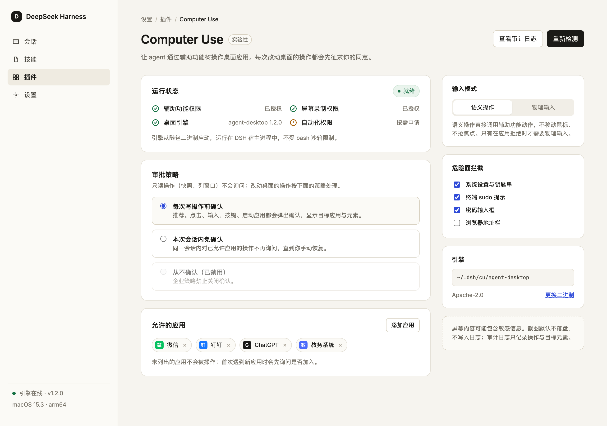
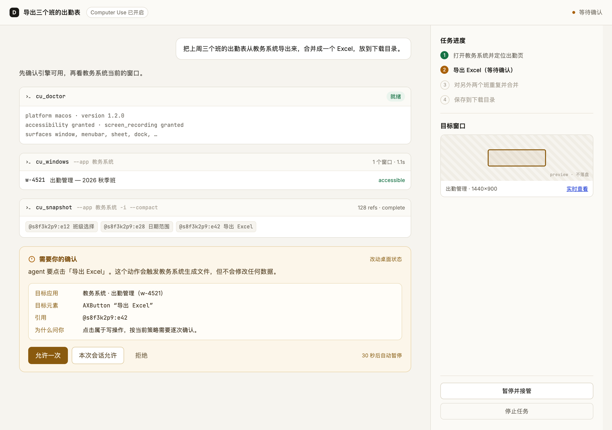
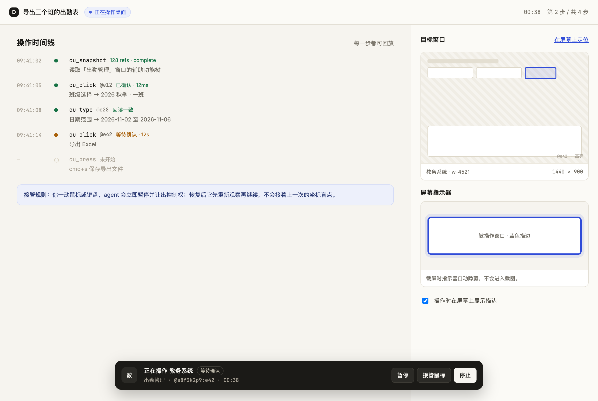

# dsh-cu

DSH 的 Computer Use 插件：让 agent 通过**辅助功能树**看见并操作桌面应用（macOS AX / Windows UI Automation / Linux AT-SPI），后端复用 [vercel-labs/agent-desktop](https://github.com/vercel-labs/agent-desktop) v1.2.0（Apache-2.0）。

| 设置 | 工具调用与审批 | 运行控制条 |
|---|---|---|
|  |  |  |

> 界面示意图（设计稿）。实际使用中：确认卡片由 DSH 宿主原生渲染；控制条出现在 composer 下方，agent 操作桌面时实时显示目标应用、元素与耗时，支持暂停 / 停止。

## 工具面（14 个）

| 只读（不询问） | 写操作（过审批闸门） |
|---|---|
| `cu_doctor` 权限与就绪体检 | `cu_click` 点击元素（ref） |
| `cu_apps` 应用列表 | `cu_type` 输入文本（stdin 传参） |
| `cu_windows` 窗口列表 | `cu_press` 键盘组合 |
| `cu_snapshot` 辅助功能树快照（ref 模型） | `cu_set_value` 直接设值（带回读校验） |
| `cu_find` 按角色/名称找元素 | `cu_scroll` 滚动 |
| `cu_screenshot` 截图兜底（树缺失时用） | `cu_launch` 启动应用 |
| `cu_clipboard_get` 读剪贴板 | `cu_clipboard_set` 写剪贴板（长文本/中文路径） |

agent 侧循环：`cu_snapshot` → 对 ref 执行动作 → 再次 `cu_snapshot` 验证。ref 属于其快照（`@<snapshot_id>:eN`），过期/跨窗引用会被后端拒绝并要求重新观测。

## 安全模型

- **审批闸门**（`tools/pre-execute`）：写操作升级为 `ask`，由宿主 approval seam 弹确认；无人应答时失败关闭（fail-closed）。
- **会话授权**：审批策略设为「会话内免重复确认」时，同一工具首次批准后本会话免问（按工具隔离，执行成功才记授权）。
- **危险应用拦截**：系统设置 / 钥匙串 / 终端等默认拒绝（可关）。
- **应用白名单**：设置里列出允许的应用后，名单外一律拒绝（对 args 里带 app 的调用生效）。
- **审计日志**：每次写操作记一行 JSONL 到 `~/.dsh/cu/audit.jsonl`——只记目标（app/ref/文本长度），不记内容。
- **后端自带护栏**：无头语义操作不抢焦点；`cmd+q` 等危险快捷键 `POLICY_DENIED`；错误带 `retry: safe/unsafe` 处置建议。

## 安装

**桌面应用（推荐）**：在应用的插件管理里从 npm / Git 安装 `dsh-cu`，重启应用即用。
依赖（`@deepseek-ai/dsh-tools` 等）由宿主运行时提供，无需手动安装。

**CLI profile（web / headless）**：

```bash
# 从 npm（发包后）
dsh plugin --profile web add dsh-cu
# 或从 Git 仓库
dsh plugin --profile web add "dsh-cu@https://github.com/<you>/dsh-cu.git"
# 本地开发（link 方式需要在插件目录里 pnpm install 一次，提供依赖解析）
dsh plugin --profile web add "dsh-cu@link:<插件目录的绝对路径>"
```

**首次使用前**：在「系统设置 → 隐私与安全性」给宿主授予**辅助功能**（必需）与
**屏幕录制**（仅 `cu_screenshot` 需要）权限；非 macOS 平台把对应平台的
agent-desktop 二进制放入 `vendor/`（或用 `CU_BIN` 指定），见
[THIRD-PARTY-NOTICES.md](THIRD-PARTY-NOTICES.md)。
```

## 配置

设置页「插件 → 可配置」里会出现 **Computer Use** 表单（由 `export const Config` 自动生成）：

| 字段 | 说明 |
|---|---|
| approvalPolicy | `ask`（默认，每次写操作确认）/ `session`（会话内免重复确认） |
| allowedApps | 逗号分隔的应用白名单，留空不限制 |
| inputMode | `semantic`（默认，语义操作）/ `headed`（物理输入） |
| auditEnabled | 审计日志开关（默认开） |
| guardDangerous | 危险应用拦截（默认开） |

环境变量兜底：`CU_BIN`（二进制路径）、`CU_APPROVAL`（首启审批策略）、`CU_TIMEOUT_MS`。

## 本地验证

```bash
node scripts/smoke.mjs       # 工具 schema 与 argv 构造
node scripts/host-smoke.mjs  # 审批闸门决策路径（mock 宿主）
node scripts/e2e.mjs         # 对真实二进制（需辅助功能权限）
```

## 已知边界

- 白名单只对参数里显式带 app 的调用生效；ref 类动作（click/type）的归属应用由快照决定，仅受审批闸门保护。
- macOS 上微信等部分应用 `accessible:false`（无辅助功能树）——只能走截图 + 物理输入路径。
- 客户端定制卡片（设计稿「运行状态/审计浏览」）待 0.2.x 的 `settings.plugins.tab` 插槽接入；当前用自动生成的 Config 表单。
